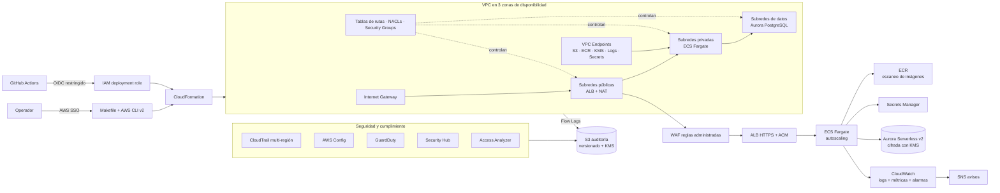

# AWS Secure Landing Zone · CLI-native

**Idioma:** [English](README.md) · Español

> Arquitectura de referencia AWS orientada a producción, operada desde terminal.

Este repositorio propone una landing zone segura para entornos `dev` y `prod`. La operación usa AWS CLI v2, AWS SSO, CloudFormation, validaciones locales y controles explícitos antes de crear recursos.

## Flujo de arquitectura

El operador inicia sesión mediante AWS SSO. El `Makefile` coordina los scripts por fases y CloudFormation crea los componentes en orden. La aplicación se expone únicamente mediante HTTPS; ECS y Aurora permanecen en subredes privadas y los registros se envían a los servicios de seguridad y observabilidad.



## Cómo leer el diseño

1. **Acceso:** SSO evita llaves estáticas y OIDC limita el acceso de CI/CD al repositorio y rama autorizados.
2. **Red:** las subredes públicas contienen solo componentes de borde; las tareas y la base de datos no reciben acceso directo desde Internet.
3. **Aplicación:** WAF filtra tráfico, el ALB termina TLS y distribuye hacia ECS Fargate.
4. **Datos:** Aurora vive en subredes de datos, cifra con KMS y recibe credenciales desde Secrets Manager.
5. **Seguridad:** CloudTrail, Config, GuardDuty, Security Hub y Access Analyzer generan controles y señales de auditoría.
6. **Operación:** CloudWatch centraliza logs y métricas; SNS distribuye alertas; S3 conserva evidencias con bloqueo público.

## Inicio rápido

```bash
git clone git@github.com:Emanuelgm98/AWS-secure-landing-zone-cli-native.git
cd AWS-secure-landing-zone-cli-native
aws sso login --profile <perfil>
python scripts/validate.py && python -m unittest discover -s tests -v
python scripts/plan.py --environment dev
```

Verifica siempre la cuenta antes de desplegar:

```bash
aws sts get-caller-identity --profile <perfil>
aws configure get region --profile <perfil>
```

## Estado

La base incluye plantillas, contratos, planes locales, pruebas y documentación. La ejecución local no crea ni elimina recursos AWS. Antes de un despliegue real deben revisarse certificado ACM, dominio, cuenta, permisos, límites de servicio, costos, respaldos y RTO/RPO.

Consulta también [arquitectura detallada](docs/ARCHITECTURE.md), [fases](docs/PHASES.md) y [revisión de Fase 0](docs/phase-0-review.md).

## Licencia

MIT. Consulta [LICENSE](LICENSE).
