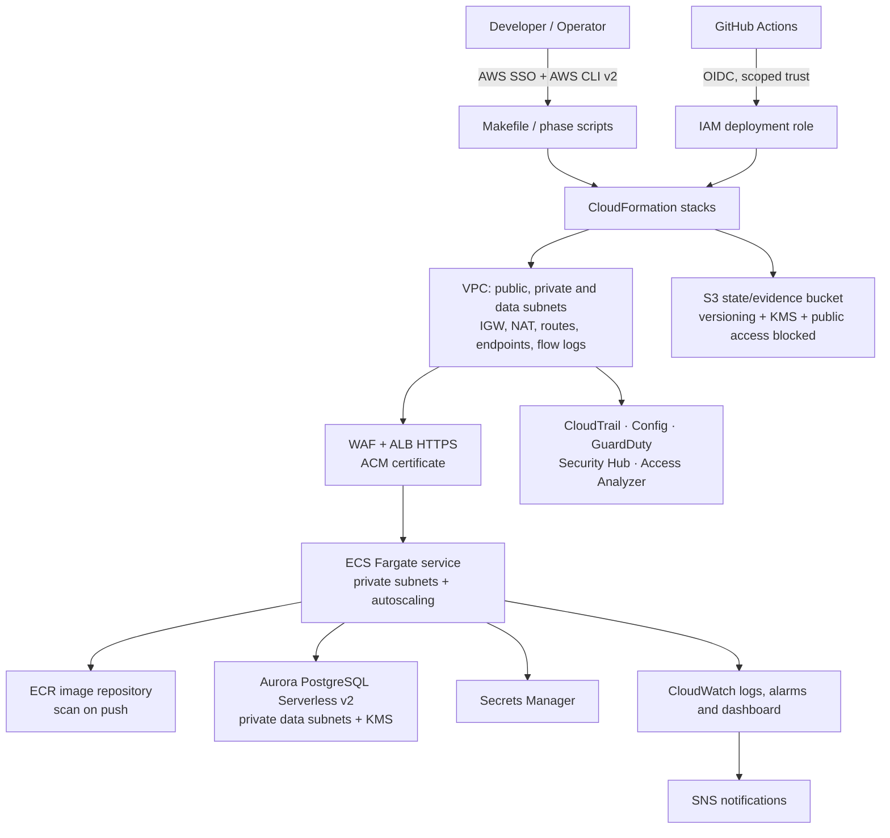

# AWS Secure Landing Zone · CLI-native

> A production-minded AWS landing-zone reference built for terminal-first operations.

This repository is a CLI-native reference implementation for isolated `dev` and `prod` environments. It uses AWS CloudFormation JSON, AWS CLI v2 conventions, local contract tests and explicit safety gates.

  

## Architecture



## What this solves

- Repeatable network, compute, data and security foundations.
- Environment-specific cost and resilience choices.
- No long-lived AWS access keys: use AWS SSO locally and GitHub Actions OIDC in CI/CD.
- A reviewable path: validate → plan → approve → deploy → verify → destroy.

## Quick start

The current repository validates locally and does not deploy automatically:

## Quick start (local only)

```powershell
python scripts/validate.py
python -m unittest discover -s tests -v
python scripts/plan.py --environment dev
./scripts/run-local-checks.ps1
```

```bash
git clone git@github.com:Emanuelgm98/AWS-secure-landing-zone-cli-native.git
cd AWS-secure-landing-zone-cli-native
aws sso login --profile <profile>
python scripts/validate.py && python -m unittest discover -s tests -v
python scripts/plan.py --environment dev
```

Confirm the target account before any deployment:

```bash
aws sts get-caller-identity --profile <profile>
aws configure get region --profile <profile>
```

## Proposed platform

| Area | Default design | Primary control |
|---|---|---|
| Network | VPC across three AZs, public/private/data subnets, NAT and VPC endpoints | Least-routed private workloads |
| Edge | ACM, HTTPS ALB, managed WAF and optional CloudFront | TLS at the edge and HTTP filtering |
| Compute | ECR + ECS Fargate in private subnets | Non-root container and task-role separation |
| Data | Aurora PostgreSQL Serverless v2 in data subnets | KMS encryption and Secrets Manager |
| Security | CloudTrail, Config, GuardDuty, Security Hub and Access Analyzer | Central audit and preventive controls |
| Operations | CloudWatch, SNS, budgets and evidence artifacts | Alerting, cost visibility and runbooks |

Dev uses one NAT gateway, minimum Aurora capacity and optional account-level audit services disabled by default. Prod uses one NAT per AZ and stronger availability settings.

## Proposed components

- Network: VPC, two AZs, public/private/data subnets, 1 NAT for dev and 1 per AZ for prod.
- App: ALB, ECS Fargate, ECR, private tasks, CloudWatch log group.
- Data: Aurora PostgreSQL Serverless v2 at min 0.5 ACU (one writer in dev; writer plus reader in prod).
- Security baseline: CloudTrail, AWS Config recorder/delivery channel, GuardDuty, Security Hub opt-in, KMS, and illustrative least-privilege IAM/SCP policy documents.
- Operations: local validation, cost inputs, environment parameter files, and read-only evidence commands.

## Safety and status

- No credentials, tokens or private keys belong in this repository.
- Local validation never creates, updates or deletes AWS resources.
- `plan.py` is informational; it is not a CloudFormation change set.
- Account-level services and SCPs require management/delegated-administrator review.
- The next implementation step is reviewed AWS CLI deployment orchestration with idempotent state, waits, dry-run support and confirmation-gated destroy.

## Documentation

- [Architecture](docs/ARCHITECTURE.md)
- [Phase plan](docs/PHASES.md)
- [Phase 0 assumptions and costs](docs/phase-0-review.md)
- [Read-only evidence runbook](docs/runbooks/read-only-evidence.md)
- [Security policy](SECURITY.md)

## License

MIT. See [LICENSE](LICENSE).
