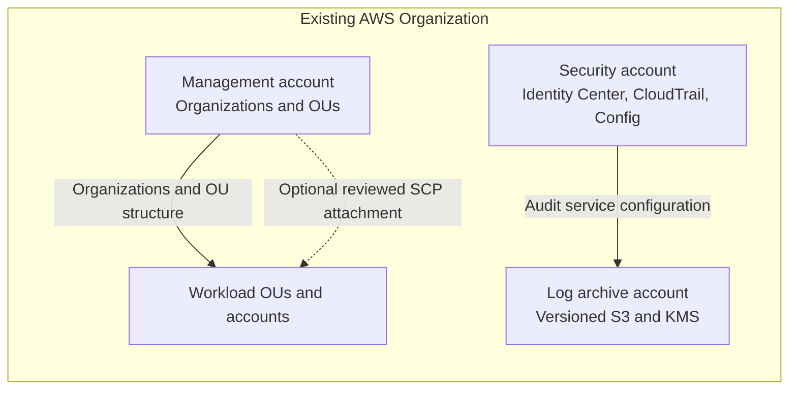

# AWS Secure Landing Zone

> **Status: DEVELOPMENT ONLY.** This repository is an un-deployed reference implementation. It has not been applied to AWS, reviewed as a production baseline, or independently validated against live AWS services. No AWS account or credentials are required for the local checks described here.

## Overview

This project is evolving from a CloudFormation CLI-native workload example into a Terraform-based, multi-account landing-zone reference. The Terraform track separates management, security, and log archive responsibilities and includes reusable examples for AWS Organizations, organizational units, service control policies (SCPs), IAM Identity Center, CloudTrail, AWS Config, and encrypted log storage.

The Terraform track is additive. Existing `templates/`, `config/`, `iam/`, and Python tooling are preserved as a separate **legacy/reference CloudFormation workload track**. They describe dev/prod workload stacks and do not deploy or configure the Terraform landing zone. Do not combine their state or deployment assumptions.

## Problem and goals

Organizations need an account boundary that makes security ownership, audit collection, identity access, and evidence retention easier to reason about. These controls must also avoid creating an unreviewed lockout path or an irreversible evidence-retention problem.

This repository provides a reviewable starting structure for those concerns. It does not claim compliance, security certification, complete account governance, or a production-ready baseline. Examples require account-specific design, policy simulation, service prerequisites, and independent operational approval before any future deployment.

## Architecture

The diagram shows the intended account responsibilities and the relationships represented by the current Terraform roots and modules. The dashed SCP relationship is an optional policy attachment; it is not applied by default.



The three independent roots in `terraform/environments/` define management, security, and log archive entry points. They are examples of account separation, not fully wired multi-account orchestration: operators must supply approved account identifiers, establish service delegation and delivery permissions, and choose isolated state handling before use. The security root currently creates its archive module locally; it does not automatically target a separately deployed log-archive account. Cross-account delivery and ownership therefore remain design prerequisites.

## Responsibilities and Terraform modules

| Path / module | Responsibility in this reference | Key boundary |
|---|---|---|
| `terraform/modules/organizations` | Organization control-plane resource and optional member-account resources | Requires an existing organization ID; account closure is disabled and accounts have deletion protection |
| `terraform/modules/organizational-units` | Create named OUs below a supplied parent | Does not attach policies automatically |
| `terraform/modules/scp` | Example SCP and explicit target attachment | Opt-in only; test inheritance, service impact, recovery access, and management-account behavior |
| `terraform/modules/iam-identity-center` | Read-only permission set example | Uses existing Identity Center; no identity source, group, or account assignment is created |
| `terraform/modules/cloudtrail` | Multi-region organization trail example | Requires a correctly configured destination bucket and KMS key policy |
| `terraform/modules/log-archive` | Versioned S3 bucket and rotating KMS key with public-access/TLS protections | No object lock, lifecycle, replication, or service-delivery bucket policy is configured |
| `terraform/modules/aws-config` | Configuration recorder, delivery channel, and recorder status | Requires a suitable role, organization/service setup, and destination permissions |
| `policies/`, `examples/` | SCP, IAM policy, and inert GitHub OIDC trust example | Examples only; replacement markers are not deployable values |

The sample archive bucket enables versioning, KMS encryption, S3 public-access blocks, denial of insecure transport, and Terraform `prevent_destroy` on selected resources. These are useful guardrails, not a complete log archive design. AWS service delivery policies, retention/lifecycle, Object Lock decisions, replication, recovery testing, and cross-account KMS access remain open prerequisites.

## Security, IAM, and OIDC

The design favors federated access through IAM Identity Center and short-lived sessions. The included permission set attaches AWS-managed `ReadOnlyAccess` as an example; that policy may be broader than a purpose-built audit role. The module creates no users, groups, assignments, or identity source. Review MFA, group ownership, session duration, least privilege, break-glass access, and periodic access reviews before adoption. See [IAM model](docs/security/iam-model.md).

SCPs define permission ceilings; they do not grant access. The sample audit-tampering SCP is not attached by any environment root. SCP effects depend on organization structure and policy inheritance; do not assume root or management-account coverage, universal protection, or prevention of lockout. Simulate the exact policy and test an independently controlled recovery path before any staged attachment. See [threat model](docs/security/threat-model.md).

The [OIDC trust example](terraform/examples/oidc-trust-policy.json) is inert JSON with replacement markers and a sample repository/ref subject constraint. No IAM OIDC provider or role is created. GitHub workflows use `contents: read`; they do not request `id-token: write`, AWS credentials, or deployment access. Before enabling CI identity, constrain organization, repository, protected ref/environment, audience, and role permissions, then review trust and workflow changes separately. See [OIDC trust guidance](docs/security/oidc-trust.md).

## Repository structure

```text
terraform/
  environments/{management,security,log-archive}/  # independent example roots
  modules/{organizations,organizational-units,scp,iam-identity-center,
           cloudtrail,log-archive,aws-config}/       # reusable references
terraform/examples/                                  # inert trust example
policies/{scp,iam}/                                  # example policy documents
docs/{architecture,security,deployment,operations}/ # design and runbooks
scripts/ tests/                                       # local validation and legacy tooling
templates/ config/ iam/                              # preserved CloudFormation track
.github/workflows/                                    # source-only CI examples
```

## Prerequisites and local validation

Local checks use Python and existing repository files. They do not require AWS CLI, an AWS account, credentials, network access, provider downloads, or installed Terraform providers. Python 3 is required for the Python scripts and tests. `make` is optional if running targets directly. No dependency installation is performed by these commands.

```sh
python scripts/validate.py
python scripts/docs_check.py
python -m unittest discover -s tests -v
```

The Makefile targets are `fmt`, `validate`, `lint`, `security`, `test`, and `docs-check`:

- `make lint` runs `scripts/validate.py` against the preserved CloudFormation contracts.
- `make security` runs `tests/test_negative_security.py` (also part of the full unit suite).
- `make test` runs the Python unit tests.
- `make docs-check` checks required documentation files are present.
- `make fmt` runs `terraform fmt -check -recursive terraform` and requires a pre-existing Terraform binary.
- `make validate` only prints a notice: provider-backed Terraform validation needs initialized providers, which this development-only workflow intentionally does not perform.

Optional source scanners may be run only if already present locally. The CI examples include Terraform formatting and Checkov scanning; Checkov is configured with `soft_fail: true`, so findings must be reviewed and CI success is not a security sign-off. The workflow named “Manual future plan” is a notice-only example and does not execute Terraform. CI action and provider version references are illustrative and require approved version review. See [deployment boundaries](docs/deployment/manual-deployment.md).

## Future manual deployment procedure

There is no active deployment path. `scripts/deploy.py`, `scripts/verify.py`, and `scripts/destroy.py` are retained legacy/reference scripts and do not deploy the Terraform roots. A future deployment requires a separately approved design and operator procedure. At minimum:

1. Confirm account ownership, Organizations enrollment, delegated administrators, service access, AWS Config roles, CloudTrail organization prerequisites, regions, and quotas.
2. Approve archive ownership, unique bucket naming, CloudTrail/Config bucket and KMS policies, retention, lifecycle, Object Lock, replication, and recovery requirements.
3. Approve IAM Identity Center identity source, groups, assignments, MFA, break-glass access, and SCP effects through policy simulation.
4. Select and review Terraform CLI/provider versions and configure an encrypted, access-controlled remote state backend with locking and tested recovery.
5. Review root-specific inputs and permissions, run validation in an approved environment, inspect a saved plan, and obtain independent change approval before any future apply.

These steps are planning requirements, not commands to run as part of local validation. No live validation, deployment, or post-deployment verification has been performed. See [prerequisites](docs/deployment/prerequisites.md) and the [manual deployment boundary](docs/deployment/manual-deployment.md).

## Destruction and recovery

No infrastructure from this Terraform reference is deployed. Future removal must be a separate, approved change. First preserve audit evidence, snapshots, state backups, and retention/legal-hold obligations; verify restore capability and map exact cross-account dependencies. Obtain data-owner and account-owner approval, inspect a reviewed plan, and maintain tested recovery access. Terraform `prevent_destroy` protects only selected resources and is not a universal deletion guarantee. Never remove it casually or destroy an organization/archive account to resolve ordinary drift. See [recovery and controlled destruction](docs/operations/recovery-destroy.md).

## Costs

This repository contains no measured usage, cost quote, or budget approval. Relevant cost drivers can include CloudTrail event volume, AWS Config recorded resources and rules, S3 storage/requests, KMS keys and requests, replication and data transfer, and future remote state storage. Estimate using the intended regions, account/resource inventory, retention, event volume, and growth scenarios with current pricing; obtain budget-owner approval before deployment. See [cost estimate](docs/cost-estimate.md).

## Limitations and threat model

This is not a compliance certification or a complete production landing zone. The examples do not finish cross-account CloudTrail/Config delivery, service-linked role and delegated-admin setup, archive lifecycle/immutability/replication, remote state controls, Identity Center assignments, workload account vending, or tested recovery. Provider-backed Terraform validation and AWS service compatibility have not been established. The provider and CLI constraints in `versions.tf` and `.terraform-version` are placeholders; workflow pins are illustrative.

The threat model covers CI trust abuse, audit tampering, evidence loss/disclosure, state exposure, supply-chain risk, and human lockout, with residual work called out. Review [threat model](docs/security/threat-model.md), [architecture decisions](docs/architecture/decisions.md), and [troubleshooting](docs/troubleshooting.md). No evidence in this repository demonstrates deployed controls or AWS test results.

## Roadmap

- Approve supported Terraform/provider versions and run offline formatting/static checks in a controlled development environment.
- Design cross-account archive delivery, KMS/key and bucket policies, retention, immutability, replication, and restore testing.
- Define state backend, locking, access review, account ownership, delegated administration, and break-glass procedures.
- Simulate SCPs and refine least-privilege IAM Identity Center permissions and reviewed OIDC trust.
- Add repeatable policy/module tests and evidence capture before considering a separately approved deployment workflow.

## Evidence still required

Local Python contract and unit checks are not evidence of Terraform provider validity or AWS behavior. Pending evidence includes reviewed CLI/provider versions, Terraform formatting and provider-backed validation, scanner findings and remediation decisions, policy simulation results, service delivery/access tests, cross-account isolation, restore/recovery exercises, cost estimates, and independent approval. Record future evidence with tool versions, date, revision, scope, and redaction notes in an approved location. The [evidence index](docs/evidence/README.md) describes current limits; `docs/evidence/local-validation.md` relates to the legacy CloudFormation track.

## Troubleshooting

- If Terraform is unavailable, Python local checks can still be run; do not install tools as part of this repository's current local-only workflow.
- `make fmt` needs an already installed Terraform CLI. Formatting has not been verified here.
- `make validate` intentionally does not run provider validation; do not initialize providers under this development-only boundary.
- AWS Organizations, CloudTrail, or Config prerequisites and archive delivery permissions are not fully implemented; consult the [troubleshooting guide](docs/troubleshooting.md) and deployment prerequisites before a separately approved future design.
- If a future SCP simulation shows unexpected denial, halt rollout and use the approved recovery path; do not remove controls without reviewing inheritance and effects.

## License and disclaimer

MIT. See the [MIT License](https://opensource.org/license/mit).

This repository is provided “as is” for development and review. It is not legal, compliance, security, or financial advice; it does not guarantee security or suitability for a particular environment. Users remain responsible for reviewing current AWS behavior, service terms, applicable requirements, costs, and all changes before use.
