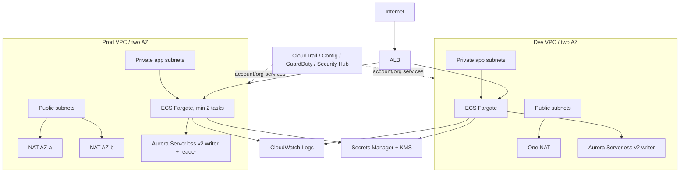

# Architecture

Each environment is a separate stack and must be deployed into a separately approved account or otherwise isolated boundary. The diagram's ALB represents one public ALB per environment, not a shared production/development load balancer. Regional resilience, DNS, certificates, backup retention and application sizing remain decisions for service owners.

## Service / reason / alternative

| Service | Reason | Alternative |
|---|---|---|
| VPC/subnets/security groups | Network segmentation and private workloads | Simpler subnet design for non-production |
| NAT Gateway | Managed egress; per-AZ in prod | NAT instance or service VPC endpoints |
| ALB + ACM | HTTPS ingress and HTTP routing | API Gateway or NLB |
| ECS Fargate + ECR | Managed container runtime and registry | EKS, ECS on EC2, Lambda |
| Aurora PostgreSQL Serverless v2 | Managed relational database, variable ACU | RDS PostgreSQL provisioned, DynamoDB |
| CloudTrail / Config / GuardDuty / Security Hub | Audit, configuration history, threat detection and posture | Organization-managed equivalents or approved external platform |
| CloudWatch, Secrets Manager, KMS | Logs/alarms, credentials, encryption | External telemetry, SSM Parameter Store for non-secrets |
| Optional CloudFront/WAF | Edge caching and web filtering | ALB direct with application-level controls |

## Cost model

See Phase 0 report for estimates. The estimate is illustrative and variable costs (NAT data processing, transfer/egress, log ingestion/retention, CloudFront, WAF, database I/O/backups) are separate. Verify exact sizes, rates, and current regional pricing in AWS Pricing Calculator.
