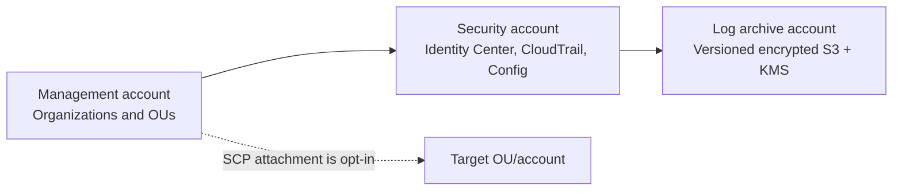

# Architecture overview

This is a development-only reference for a future AWS Organizations landing zone. No account, organization, identity provider, log archive, or control is provisioned by this repository. `management`, `security`, and `log-archive` are separate root configurations; operators must review ownership, state boundaries, prerequisites, and policy scope before any future use.

Terraform modules create organization/OUs, an example audit SCP, a read-only Identity Center permission set, organization CloudTrail, encrypted archive bucket and Config recorder. AWS Organizations/Identity Center enrollment, delegated administrator setup, service-linked roles, regional enablement, bucket policy for service delivery, replication, lifecycle/retention, and account assignments require explicit review. The current reference intentionally omits broad account vending and workload networking.

The repository began as a CloudFormation CLI-native example; existing `templates/`, `config/`, and Python scripts remain intact. They describe a separate dev/prod workload stack and are **legacy/reference material**, not Terraform inputs. Consult `docs/PHASES.md` and the old docs for that track. Do not combine state, ownership, or deployment instructions across tracks.
