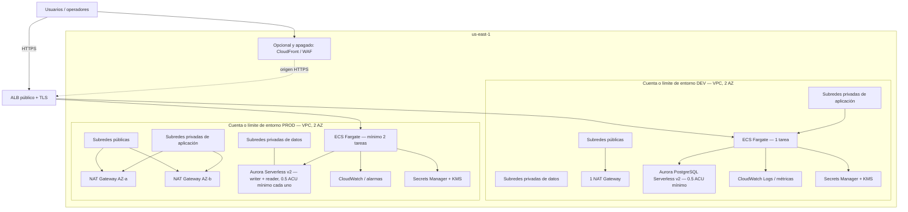

# AWS Secure Landing Zone CLI-native — Informe de Fase 0
> **Addendum de estado:** una instrucci?n posterior autoriz? continuar con las fases 1?8. El punto de parada hist?rico al final de este informe qued? superado por esa autorizaci?n. La implementaci?n posterior se limita a validaciones locales, dry-run y operaciones AWS de lectura.

**Estado:** propuesta para revisión; ninguna infraestructura ni recurso AWS fue creado, modificado o eliminado. No se ejecutaron comandos AWS.
**Alcance:** definición de arquitectura, supuestos, estimación preliminar y condiciones de aceptación. La Fase 1 queda detenida hasta recibir la aprobación literal **`ok`**.

> **Base de este informe:** no se encontró el repositorio fuente en el workspace al preparar este borrador. Por ello, esta propuesta parte de los requisitos del encargo y explicita supuestos en vez de atribuir decisiones al repositorio. Debe reconciliarse con el repositorio y sus requisitos antes de aceptar la Fase 0.

## Supuestos explícitos

1. Región de cálculo: **us-east-1 (N. Virginia)**, 730 horas/mes, precios bajo demanda en USD, sin impuestos, créditos ni compromisos de Savings Plans/Reserved Instances.
2. “Landing Zone CLI-native” se interpreta como una base de una aplicación web/API pequeña, operada después mediante AWS CLI y configuración declarativa revisable. El mecanismo declarativo (CloudFormation/CDK/Terraform) todavía no está decidido; no se implementa en esta fase.
3. Dos entornos separados (dev y prod) y VPC independientes. Se propone ECS con Fargate para evitar operar nodos; no hay evidencia del workload para justificar Kubernetes.
4. Una región y dos AZ como base; dev usa un NAT Gateway y prod un NAT Gateway por AZ (dos). Se asume tráfico de salida liviano, alineando workloads con su NAT en prod. Endpoints VPC de interfaz no están incluidos.
5. Aurora PostgreSQL Serverless v2 Standard, mínimo 0.5 ACU. Dev: una instancia de escritor; prod: escritor y una réplica de lectura en AZ distinta, ambas presupuestadas al mínimo continuo. No se supone auto-pausa a cero.
6. Tamaño ilustrativo del servicio: dev 1 tarea Fargate Linux x86 de 0.25 vCPU/0.5 GB; prod 2 tareas de 0.5 vCPU/1 GB. ALB público único por entorno, con uso bajo (LCU adicional pequeño).
7. Costos de almacenamiento ilustrativos: Aurora 20–50 GB en dev y 50–100 GB en prod; S3 50–200 GB por entorno; ECR 5–20 GB por entorno. Secretos: 3–5 por entorno. KMS: 2–4 claves administradas por cliente por entorno.
8. Recursos opcionales **apagados/excluidos** del total de base: CloudFront, AWS WAF, AWS Shield Advanced, endpoints VPC de interfaz, VPN/Direct Connect, Route 53 público, backups más allá de la retención básica, replicación multi-región, Security Hub/GuardDuty/Config organization-wide, servicios de analítica y CI/CD administrado. Marcar si se habilitan después y recalcular.
9. El coste real depende de volumen, retención, consultas/I/O, transferencia, número de secretos/llamadas, IP públicas, logs, LCU, backups y configuración exacta. Estos importes son orientativos, no una cotización.

## Arquitectura propuesta

**Aclaración:** el diagrama muestra dos entornos aislados. En la implementación deberá haber un punto de entrada por entorno; el ALB compartido en el borde del dibujo representa el patrón, no un recurso compartido entre dev y prod. Para aislamiento fuerte, preferir cuentas AWS separadas (AWS Organizations) y una cuenta de log/archive/security central, sujeto a decisión pendiente.

## Servicios, justificación y alternativa

| Servicio / componente | Justificación propuesta | Alternativa considerada |
|---|---|---|
| AWS Organizations + cuentas dev/prod (pendiente) | Aislamiento de permisos, cuotas, facturación y blast radius; foundation de landing zone | Una cuenta con VPC separadas (menor costo/operación, menor aislamiento); Control Tower para acelerar gobernanza con más alcance |
| VPC, subredes públicas/privadas, route tables, Security Groups | Frontera de red explícita; aplicación y datos sin IP pública directa | VPC por entorno con topología simplificada; Network Firewall si el control de egreso lo requiere |
| NAT Gateway: 1 dev, 2 prod | Egreso controlado desde subred privada; prod evita dependencia de una única AZ | NAT instance (menor costo, mayor carga operativa); VPC endpoints para servicios AWS y menos egreso por NAT |
| Application Load Balancer + ACM | HTTPS, health checks y enrutamiento HTTP hacia tareas | API Gateway para API gestionada; NLB para protocolos TCP o IP fija |
| ECS + AWS Fargate | Contenedores sin administrar nodos; escala por tareas y operación sencilla para workload pequeño | EKS para Kubernetes/portabilidad; ECS sobre EC2 si uso sostenido hace rentable administrar capacidad |
| ECR | Registro privado de imágenes de contenedor integrado con ECS | Otro registry privado; evaluar salida, autenticación y escaneo |
| Aurora PostgreSQL Serverless v2 (0.5 ACU mínimo) | PostgreSQL administrado con capacidad variable y almacenamiento durable | RDS PostgreSQL provisionado para carga estable; DynamoDB si el modelo de acceso es clave-valor/documento |
| Secrets Manager + KMS | Credenciales sensibles, rotación posible y cifrado con control de acceso | SSM Parameter Store para configuración no sensible; KMS AWS-managed keys para reducir claves CMK |
| CloudWatch Logs, métricas y alarmas | Diagnóstico operativo, retención controlada y alertas | OpenTelemetry hacia backend externo; S3 para archivo de logs de larga retención |
| S3 | Artefactos/objetos y posible archivo de evidencia/logs, con cifrado y versionado definidos | EFS para filesystem compartido; almacenamiento externo según requisitos |
| CloudFront y WAF (opcionales, apagados) | Caché global y filtrado administrado al exponer web pública | ALB directo si baja latencia/alcance global no son requisitos; controles en aplicación |

## Estimación mensual preliminar

### Total de base (sin variables separadas abajo)

| Entorno | Rango mensual estimado | Perfil incluido |
|---|---:|---|
| **dev** | **USD 105–165/mes** | 1 NAT × 730 h; 1 tarea Fargate 0.25 vCPU/0.5 GB; 1 ALB ligero; Aurora escritor a 0.5 ACU mínimo; almacenamiento bajo; pocas claves/secretos |
| **prod** | **USD 235–365/mes** | 2 NAT × 730 h; 2 tareas Fargate 0.5 vCPU/1 GB; 1 ALB ligero; Aurora escritor + lector a 0.5 ACU mínimo cada uno; almacenamiento moderado; más observabilidad y claves/secretos |

Rangos de trabajo para comparación, no presupuestos aprobados. Incluyen margen para almacenamiento básico, ECR, logs de bajo volumen, claves, secretos e IP públicas; excluyen transferencia/egreso, procesamiento de datos NAT, ingestión de logs y CloudFront, que se muestran aparte. No incluyen soporte AWS, impuestos, costos de actividad de CI/CD ni backup fuera de la asignación gratuita aplicable.

### Componentes de referencia que explican el rango

| Componente | Dev | Prod | Cálculo / nota |
|---|---:|---:|---|
| NAT Gateway, solo tarifa horaria | ~$32.85 | ~$65.70 | $0.045/h × 730 × 1 o 2. No incluye GB procesado ni egreso |
| Fargate (Linux x86, on-demand) | ~$9 | ~$36 | Supuesto ilustrativo: dev 0.25 vCPU/0.5 GB × 730 h; prod 2 × (0.5 vCPU/1 GB × 730 h). Confirmar tarifa vigente en calculadora |
| ALB, base | desde ~$16.43 | desde ~$16.43 | $0.0225/h × 730; LCU según solicitudes, conexiones y bytes se añade |
| Aurora Serverless v2 compute mínimo | ~$43.80 | ~$87.60 | $0.12/ACU-h × 0.5 ACU × 730 h × 1/2 instancias. Almacenamiento, I/O, backup y transferencia aparte |
| Aurora storage | ~$2–12 | ~$5–23 | 20–50 / 50–100 GB × referencia $0.10–0.225 por GB-mes según configuración/precio aplicable; validar opción Standard y región |
| Secrets Manager | ~$1.20–2 | ~$1.20–2 | 3–5 secretos × $0.40/mes, llamadas API adicionales |
| KMS CMK | ~$2–4 | ~$2–4 | 2–4 claves × cerca de $1/mes por clave, más solicitudes |
| S3 + ECR + monitoreo básico + IP públicas | ~$8–40 | ~$20–75 | Reserva indicativa; depende sobre todo de logs, retención, datos e IP facturables |

Aurora Serverless v2 permite 0 ACU como capacidad inicial en opciones compatibles, pero el encargo exige cotizar el **mínimo operativo de 0.5 ACU**; por eso no se presupone que el cluster se pause a cero. La tarifa publicada de referencia de $0.12/ACU-h implica ~$43.80 por instancia mínima continua en 730 horas.

### Costos variables / opcionales separados

| Variable / recurso opcional | Tratamiento en esta estimación |
|---|---|
| **Procesamiento NAT** | Excluido; referencia de $0.045/GB procesado, además de la tarifa horaria. Egreso a Internet y tráfico entre AZ se cobran según sus propias tarifas. Priorizar endpoints Gateway de S3/DynamoDB cuando corresponda y alinear workloads con NAT por AZ. |
| **Transferencia a Internet** | Excluida. Modelo de planificación: 100 GB/mes podrían ser aproximadamente USD 0–9 de transferencia de salida según elegibilidad/cuota agregada vigente y origen; arriba de la cuota, usar tarifa regional de EC2/servicio. Transferencia entre AZ/regiones puede añadir cargos. Verificar escenario real en Calculator. |
| **CloudWatch Logs** | Excluido del total y de base solo con reserva baja: referencia de ingestión $0.50/GB en us-east-1; almacenamiento/retención, consultas Logs Insights, métricas custom y alarmas suman. Por ejemplo, 10 GB ingeridos ≈ $5 más almacenamiento/consultas. |
| **CloudFront** | Apagado/excluido. Factura por GB desde edge, solicitudes HTTP(S), invalidaciones o funciones según uso y región edge. Estimar con GB de salida y solicitudes mensuales reales; transferencia del origen AWS a CloudFront tiene condiciones de precio específicas. |
| **AWS WAF** | Apagado/excluido. Suma tarifa por Web ACL/reglas y solicitudes; confirmar configuración/región en Calculator. |
| **VPC interface endpoints** | No incluidos; cada endpoint y AZ añade costo horario y por GB. Comparar su costo con NAT processing/egress. |
| **Backups / snapshots / retención de logs** | Supuestos mínimos; retenciones largas, copias y exportaciones de logs aumentan almacenamiento y solicitudes. |

**Verificación requerida con AWS Pricing Calculator:** crear estimaciones separadas para dev y prod en us-east-1; introducir 730 h/mes, NAT Gateway (1/2) y GB procesados; ECS/Fargate con CPU/memoria/arquitectura exactas; ALB y LCU; Aurora PostgreSQL Serverless v2 Standard con mínimo 0.5 ACU, número de instancias 1/2, GB de almacenamiento, I/O y backup; IP públicas; Secrets Manager/llamadas; KMS keys/requests; CloudWatch GB ingestados, retención/consultas; ECR/S3; y añadir por separado CloudFront, WAF, egress e inter-AZ con métricas esperadas. Guardar exportación y fecha de precios para revisión. La calculadora es la fuente final de estimación aplicable a la cuenta y configuración.

Precios de referencia consultados en páginas oficiales de AWS: [Aurora](https://aws.amazon.com/rds/aurora/pricing/), [VPC/NAT](https://aws.amazon.com/vpc/pricing/), [ECS/Fargate](https://aws.amazon.com/fargate/pricing/), [ALB](https://aws.amazon.com/elasticloadbalancing/pricing/), [CloudWatch](https://aws.amazon.com/cloudwatch/pricing/), [Secrets Manager](https://aws.amazon.com/secrets-manager/pricing/), [S3](https://aws.amazon.com/s3/pricing/), [CloudFront](https://aws.amazon.com/cloudfront/pricing/) y [AWS Pricing Calculator](https://calculator.aws/). Tarifas y cuotas pueden cambiar; revisar de nuevo al aprobar y diseñar la Fase 1.

## Riesgos

- Falta de repositorio/requisitos fuente: servicio y límites de workload pueden diferir de la intención del proyecto.
- NAT de dev da menor resiliencia zonal; el fallo de su AZ corta egreso mientras la aplicación puede seguir activa. Prod con NAT por AZ reduce ese riesgo, pero aumenta costo fijo.
- Aurora a 0.5 ACU puede no satisfacer latencia, concurrencia, conexiones o picos; la réplica de prod duplica computación mínima y no reemplaza prueba de recuperación.
- ECS Fargate, ALB, Aurora y NAT pueden exceder la banda por demanda, almacenamiento, I/O, logs, egress, IP y costo entre AZ.
- Una sola región no protege frente a interrupción regional. Multi-región y RTO/RPO siguen sin definir.
- Cuenta compartida, IAM demasiado amplio, exposición de secretos, políticas de red permisivas o falta de guardrails pueden debilitar el aislamiento.
- Logs excesivos/retención indefinida y falta de etiquetas/presupuestos dificultan control de costos y auditoría.
- CloudFront/WAF, endpoints privados y servicios de detección pueden añadir costos y dependencias de configuración no incluidos.

## Decisiones pendientes antes de Fase 1

1. Ruta y contenido del repositorio, requisitos funcionales/no funcionales y definición exacta del alcance “landing zone”.
2. Organización de cuentas: AWS Organizations/Control Tower y cuentas separadas, o una cuenta con entornos aislados; propietarios y roles de acceso.
3. Motor y workload: confirmar ECS/Fargate frente a EKS/EC2/Lambda; imagen/arquitectura, CPU/memoria, réplicas, escalado y ventana de operación dev.
4. Base de datos: PostgreSQL vs MySQL, necesidad real de Aurora Serverless v2, HA (réplica), backups, retención, cifrado, acceso y RTO/RPO.
5. CIDR, AZ definitivas, conectividad egress, endpoints VPC y aceptación de NAT único en dev.
6. DNS/domino, ACM, exposición pública, CloudFront/WAF y reglas de entrada.
7. Cifrado/KMS, secretos/rotación, requisitos de auditoría y retención de logs.
8. Presupuesto máximo por entorno, alarmas de costo, límites de escalado y etiquetado obligatorio.
9. Herramienta declarativa y su flujo de aprobación, estados/artefactos, drift detection y guardrails CLI/IAM; no se decide ni genera en esta fase.
10. Validación de precios de AWS Calculator y aprobación del diseño por responsable técnico/seguridad.

## Criterios de aceptación de Fase 0

- El repositorio y alcance quedan identificados, o las desviaciones se registran explícitamente como supuestos.
- Un responsable aprueba el diagrama, separación de entornos/cuentas, modelo de red, servicios y alternativas.
- Estimaciones de Calculator de dev/prod quedan exportadas y trazables con región, fecha, horas, tamaños, tráfico y supuestos; los costos variables aparecen aparte.
- Cada recurso opcional está marcado apagado/excluido o aprobado con impacto económico y operativo.
- Riesgos, RTO/RPO, seguridad, IAM, auditoría, costos y decisiones pendientes tienen propietario/acción o aceptación documentada.
- No se creó código de infraestructura ni se ejecutaron operaciones mutantes en AWS durante esta fase.
- El usuario entrega la aprobación literal **`ok`** para cerrar Fase 0. Esa aprobación permite considerar el paso siguiente; este informe no inicia Fase 1.

## Checklist de evidencia de Fase 0

- [ ] Ruta del repo y requisitos vigentes revisados; versión/commit o fecha consignada.
- [ ] Supuestos explícitos confirmados o corregidos por responsables.
- [ ] Diagrama Mermaid revisado y decisiones de aislamiento señaladas.
- [ ] Tabla de servicios y alternativas revisada.
- [ ] Exportaciones de AWS Pricing Calculator de dev y prod adjuntas, con configuración, fecha y región.
- [ ] Volumen de NAT, egress, transferencia entre AZ, CloudWatch y CloudFront anotados como variables.
- [ ] Recursos opcionales y decisión de encendido/apagado registrados.
- [ ] Riesgos, decisiones pendientes y criterios de aceptación revisados con propietarios.
- [ ] Evidencia negativa de alcance: no hay scripts/infraestructura nuevos ni comandos AWS mutantes ejecutados en Fase 0.
- [ ] Aprobación literal `ok` recibida antes de considerar cualquier trabajo posterior.

**Punto de parada:** este entregable termina en Fase 0. Quedo a la espera de la aprobación literal **`ok`**; no continúo a Fase 1.
